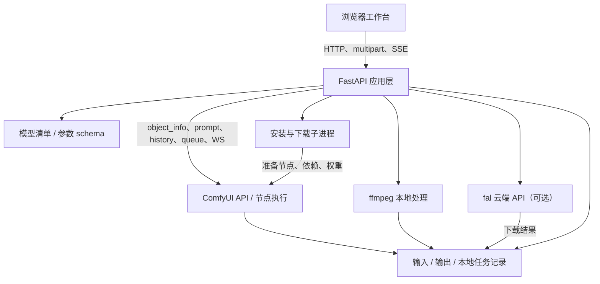
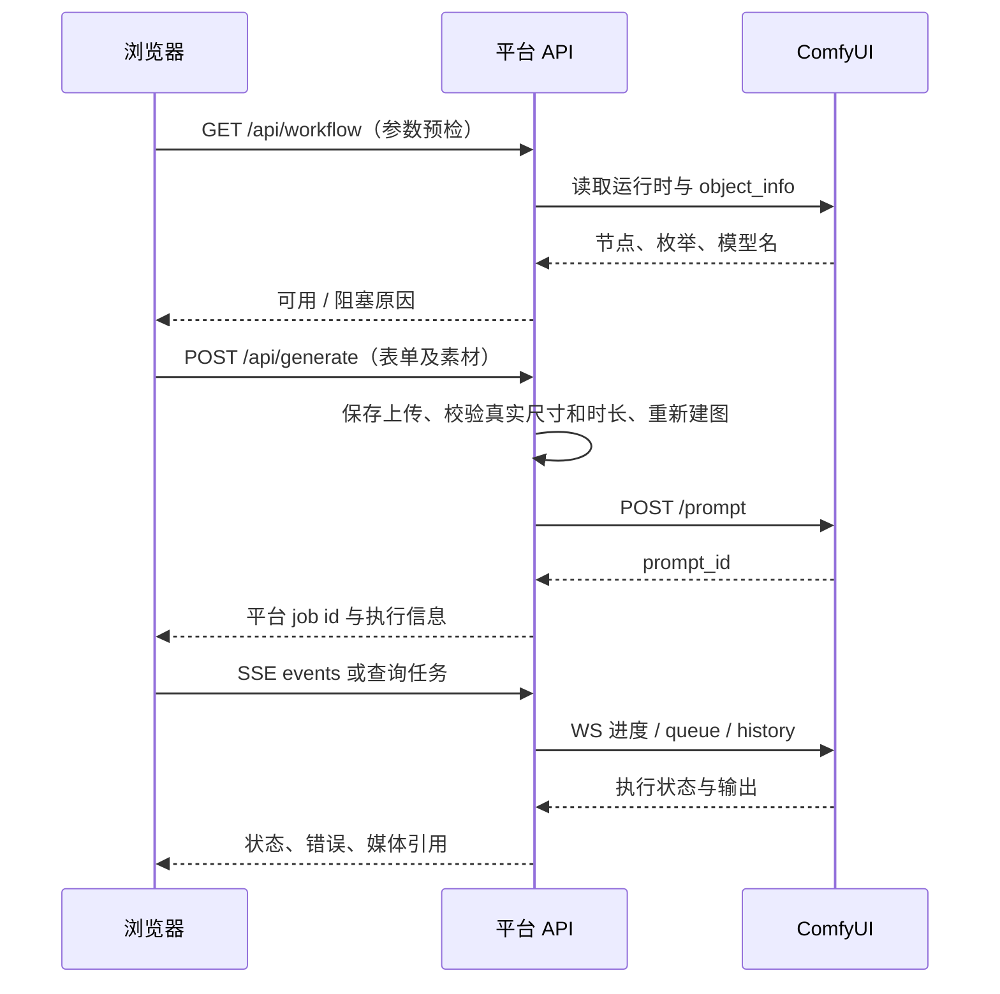

# 技术架构与运行原理

本文解释当前仓库如何工作，不是未来架构提案，也不是实时部署状态报告。整理日期：2026-10-28。

阅读顺序：[README](README.md) → 本文 → [模型工作流原理](MODEL_WORKFLOWS.md)。操作步骤见[使用教程](BEGINNER_FRONTEND_GUIDE.md)，接口字段见[API 指南](AI_PLATFORM_USAGE_GUIDE.md)。

## 1. 架构定位

这是一个**本地优先、任务驱动的 ComfyUI 应用层**：

- 浏览器负责交互、草稿、素材交接和可选的后期自动衔接。
- FastAPI 负责运行时发现、能力解析、参数约束、构建节点图、提交任务与管理结果。
- ComfyUI 负责加载模型、执行节点和实际推理。
- ffmpeg 负责部分不需要扩散模型的媒体处理。
- Python 安装脚本负责准备环境和资产。
- fal 是独立、可选的云端执行路径，不依赖本机 ComfyUI 推理。

前端使用原生 HTML/CSS/JavaScript，没有 React/Vue 构建步骤；后端由 Uvicorn 承载 FastAPI。运行前端的依赖见 [requirements.txt](requirements.txt)，与 ComfyUI 的 PyTorch/节点环境分开。



## 2. 代码地图

| 模块 | 职责 |
| --- | --- |
| [START_WORKFLOW.py](START_WORKFLOW.py) 及 BAT / PS1 / command 包装 | 找兼容 Python、准备前端 venv、探测服务、启动前端 |
| [beginner_frontend/app.py](beginner_frontend/app.py) | FastAPI 路由、运行时发现、模型路由、主建图函数、预检、安装与任务管理 |
| [model_catalog.py](beginner_frontend/model_catalog.py) | 资产清单、安装包、节点来源和模型接入等级 |
| [video_params.py](beginner_frontend/video_params.py) | 各视频 mode 的参数 schema、默认值与 H3 采样档 |
| [image_studio.py](beginner_frontend/image_studio.py) | 图片档位、尺寸/编辑规则和图片节点图 |
| [h3_workflows.py](beginner_frontend/h3_workflows.py) | H3 Attention、控制、重绘和潜空间超分的图扩展 |
| [social_presets.py](beginner_frontend/social_presets.py) | 发布版式与模型参数配方，不负责自动发帖 |
| [media_metadata.py](beginner_frontend/media_metadata.py) / [job_queries.py](beginner_frontend/job_queries.py) | 视频元数据、任务筛选与分页 |
| [static/app.js](beginner_frontend/static/app.js) | 主界面、模型联动、提交、任务事件和后期衔接 |
| [workflow-state.js](beginner_frontend/static/workflow-state.js) / [workbench-journey.js](beginner_frontend/static/workbench-journey.js) | 无网络副作用的素材状态规则和入口导航 |
| [image-studio.js](beginner_frontend/static/image-studio.js) / [download-center.js](beginner_frontend/static/download-center.js) | 图片工作台和下载管理交互 |
| [install_comfyui.py](scripts/install_comfyui.py) / [install_workflow_assets.py](scripts/install_workflow_assets.py) | ComfyUI、PyTorch、节点依赖和资产安装 |
| [workflows/](workflows/) | 手工参考图，不是所有动态工作流的唯一来源 |

当前仍以较大的 `app.py`、`app.js` 为中心，属于模块化的单服务应用，不是微服务、插件沙箱或通用分布式调度系统。

## 3. 两套 Python 与四类目录

### 为什么分环境

前端只需要 Web、图片读取和媒体管理依赖；实际加载扩散模型的是 ComfyUI Python。前端没有 torch，不等于 ComfyUI 没有 CUDA/MPS。把节点依赖装进前端 `.venv`，也不能修复 ComfyUI 的节点导入错误。

启动器优先准备项目内 `.venv`；必要时查找可用的备用 Python。当前启动与安装策略支持 3.10–3.12。这不是“更高 Python 版本一定更快”的性能结论。

### 路径含义

| 名称 | 内容 | 注意事项 |
| --- | --- | --- |
| 项目目录 | 前后端代码、启动器、文档 | 不一定是 ComfyUI 目录 |
| ComfyUI 源码目录 | `main.py` 与 ComfyUI 程序 | Desktop bundled runtime 与源码安装路径可能不同 |
| ComfyUI active base | `models/input/output/custom_nodes` 等数据 | 安装与读取素材应跟随当前运行实例 |
| 独立模型下载目录 | 大权重存储 | 平台可注册额外模型路径；不能只移动文件却不更新配置 |

默认 base 先考虑显式环境配置；只有父目录同时包含 `models/input/output/custom_nodes` 等特征时才复用父目录，否则使用项目相关默认位置。连接到 ComfyUI 后，后端还会读取 `/system_stats` 中的启动参数，解析实际 base、input、output 和 main.py。

这就是环境页同时展示“配置目录”和“实际目录”的原因：**模型下载到了 A，而正在运行的 ComfyUI 读取 B，是一种独立错误。**

```text
project/
  START_WORKFLOW.py
  beginner_frontend/
  scripts/
  workflows/
  .venv/                          前端环境，不发布
  .runtime/jobs.json              平台任务记录，不发布
  .local_ai_workbench_config.json 本地设置，不发布

comfy-runtime/                    可以在别处
  main.py
  .venv/                          实际位置以运行时发现为准

comfy-data/                       可以与源码目录重合
  models/
  custom_nodes/
  input/beginner_frontend/
  output/
```

这是逻辑示意，不是要求用户照此迁移目录。输出也可能被单独配置，最终以接口返回路径为准。

## 4. 从选模型到节点图

### 三种 ID 不能混用

| 概念 | 作用 | H3 T2V 示例 |
| --- | --- | --- |
| 安装 profile | 决定下载哪些资产和节点 | 从安装计划读取，不猜 ID |
| `model_profile` | 具体可运行的模型/任务档 | `minimax_h3_fl2va_int8_t2v` |
| `mode` | 选择建图与执行分支 | `minimax_h3_t2v` |

同一个模型家族可以有多种 mode；同一个安装包也可以支持多个运行档。模型目录里的手动条目未必有原生 mode。下载一个任意 safetensors，不会自动让平台理解它的结构。

### 解析过程

1. 前端读取环境、目录、参数 schema 和支持的能力。
2. 用户选择模型，界面同步输入要求、帧率、尺寸、安装计划及默认参数。
3. 后端通过 `resolve_workflow_profile()` 解析实际 mode 和模型配置。
4. 参数标准化后，由对应 `build_*_prompt()` 构造 API 图。
5. `resolve_graph_model_option_names()` 将清单名解析成当前 `/object_info` 返回的实际名称。
6. 根据当前节点 schema 检查必填输入、模型枚举、图引用和平台限制，再决定是否允许提交。

跨平台适配不是简单把反斜杠替换成斜杠。模型可能在不同子目录中，节点接口也可能升级，因此需要运行时解析。例如 `SaveVideo` 的平面 `codec` 与新版 `format.codec` 需要按连接到的节点 schema 转换。

### API 图与编辑器图

- **API 图**：以节点 ID 为键，包含 `class_type`、`inputs` 和节点引用，供 `/prompt` 执行。
- **编辑器图**：包含节点位置、连线和 widgets 等 UI 信息，适合在 ComfyUI 中打开。
- 两者不是任意可交换的文件格式。平台动态建图不需要先修改某个固定 JSON 模板。
- `workflows/ready/` 主要用于手工操作，`workflows/mac/*_api.json` 是 API 格式示例。

## 5. 一次生成的生命周期



预检不会保证显存足够或模型内部无错误。上传后的真实媒体校验也不能被 `has_image=true` 之类布尔标记替代。

平台 ID 与 ComfyUI `prompt_id` 是不同标识。一次图片批量任务可能对应多个 prompt；ffmpeg 或云端任务也不应硬套 ComfyUI ID。

任务通过内存表管理，默认持久化到 `.runtime/jobs.json`，有锁、写入节流与历史条数限制。它是轻量状态存储，**不是支持任意多 worker 的事务数据库**。部署保持默认单 Uvicorn 进程，不要直接增加 workers 来提高推理吞吐。

### 进度与查询的副作用

前端优先使用 SSE，后端可消费 ComfyUI WebSocket 进度，并结合队列/历史刷新；不能接收事件时可轮询。

- `completed=true` 只代表终态，失败和取消也会结束；应检查 `status`、错误和实际输出。
- `GET /api/jobs/{id}?refresh=false` 返回已记录快照。
- 默认 `refresh=true` 和事件流会刷新生命周期；在配置允许且队列空闲时，完成收尾可能请求 ComfyUI `/free` 释放模型。
- 因此“只是查询 GET”不一定是完全无资源副作用的只读行为。资源冻结期间使用快照接口，不启动环境探测、预检或推理。

### 三种状态存储

| 状态 | 保存位置 | 丢失或停止的影响 |
| --- | --- | --- |
| 页面草稿、当前素材关联、操作参数 | 浏览器 localStorage | 换浏览器/清除站点数据不保证恢复 |
| 平台任务与错误记录 | 后端内存 + jobs.json | 不是输出文件副本；后端重启不等于所有本地子进程可续跑 |
| 排队与推理执行 | ComfyUI 或云服务 | 浏览器退出后已提交任务可能继续，须查任务而非重复提交 |

上传的浏览器 File 对象不会靠 localStorage 恢复；刷新后需要重新选择尚未提交的本地文件。

## 6. 素材交接与自动后期

`WorkbenchState` 用 `revision` 区分当前镜头，用各工具的最新任务 ID 防止旧完成通知覆盖新素材，并记录已处理通知避免重复触发后续步骤。

手动「继续处理」把用户点选的那份结果设为新输入。工具可以独立打开，因此“超分后再调色”合法，不必回到旧原片。移除素材或新镜头只清除界面关联，不删除文件、不取消后台任务。

自动后期与手动处理分开：

1. 生成提交时保存所选后期步骤和参数快照。
2. 当前镜头成功完成后，由浏览器发起下一步骤。
3. 每一步成功后传递该步输出，失败时停止。
4. 后续修改表单不改变已经保存的链路参数。
5. 关闭页面或多镜头并行时，不承诺全部结果无人值守衔接。

**当前没有服务端持久化 DAG 调度器。** 需要可靠批处理的外部程序应显式保存任务 ID、轮询终态、逐步提交，处理重启和超时，不依赖网页一直在线。

## 7. 环境安装与硬件策略

安装流程分成：发现已有 runtime → 选择目标档 → 计算缺失与空间 → 下载模型 → 安装节点与其 Python 依赖 → 用户确认重载 → 运行时预检 → 短片实测。

- 有 Git 时使用仓库方式；缺 Git 的部分安装路径可使用 ZIP。
- 下载支持 `.part`、Range 续传、重试及本地缓存复用。
- 能识别实际 ComfyUI Python 时，节点依赖安装到该环境，不是前端 venv。Desktop 未暴露可用 Python 时，可能仍需在 Desktop 管理器中安装依赖；不能把节点源码已复制理解为依赖全部装好。
- 一键准备不是事务：网络或依赖中途失败，已安装内容通常仍保留，需要看日志继续修复。
- 通用资产下载目前主要依据文件字节数与远端大小校正；部分清单带 SHA256 元数据，不代表所有下载/缓存复用路径都完成密码学校验。不要将“文件存在”描述为来源和内容已被全面验证。

硬件检测分别考虑前端 torch、ComfyUI Python、ComfyUI 设备报告以及系统探测。Mac 另查 Apple 芯片、统一内存和 MPS。

推荐值用于选择起点，不是显存调度器。没有自动显存池化、多卡切分或对 vLLM 等外部服务的资源仲裁。CPU/MPS/CUDA 的不同标记不能只由前端 torch 是否已安装来决定。

当前默认值还未完全集中：`catalog_model_for_hardware()` 在 40–79GB 返回 LTX 2.3 Dev，而 `install_profile_for_hardware()` 返回 LTX 2.5 INT8；已选目录项还会影响最终安装档。文档不将它描述成完全统一的自动推荐，操作时应显式确认目标与安装计划。本次文档重构未改这些运行逻辑。

## 8. 部署、认证与隐私

`both`、`server`、`client` 是同一应用的运行角色。首次未配置时启动器默认监听回环地址；保存 server/both 并重启后可能监听 `0.0.0.0`，可用 `BEGINNER_FRONTEND_HOST` 显式约束。

客户端主要调整浏览器 API 目标，指向运行本平台的服务器。服务器应能访问自己的 ComfyUI 和媒体文件。单独把 `COMFY_URL` 指向另一台机器，不等于建立了共享文件系统或完整远程部署。

非回环访问的写接口和部分受保护读接口使用共享令牌，支持 `X-Local-AI-Token` / Bearer 等形式。部分浏览器媒体与事件请求使用查询参数传令牌，因此日志和分享链接需要额外小心。

这套机制不等于 RBAC、多租户隔离、审计平台或完整公网认证。限制在可信网络，必要时由维护者配置受控网络与 HTTPS；不要直接转发公网端口。

本地 Prompt 与素材送入本地 ComfyUI；选 fal 时会发送到服务商且可能计费。安装、模型搜索和下载也会访问网络。“本地优先”不等于全流程永不联网。

`FAL_KEY` 在后端读取；HF 凭据用于受限模型下载。不要把真实密钥写进指南、工作流、任务参数或 Git。

## 9. 重启与兼容

| 改动 | 通常需要 |
| --- | --- |
| 静态 JS/CSS | 刷新页面；后端内容指纹帮助更新缓存 |
| 平台 Python 源码 | 正常重启前端服务 |
| 新装/升级 ComfyUI 自定义节点 | 在无任务时重启 ComfyUI |
| 切换模型权重 | 检查模型列表与预检，必要时重载 ComfyUI |
| 修改服务绑定地址 | 重启前端并核对监听地址 |

HTML 静态资源兼容 `?v=` 和 `?build=`，新版服务按内容生成缓存指纹。但缓存更新不能热替换已经运行的 Python 后端。

旧 `.wan22_workflow_config.json` 和部分 `WAN22_*` 变量用于兼容；不要仅因名字旧就删除。模板编号也不是全局工作流顺序。

## 10. 维护与验证

文档或纯逻辑修改应优先使用离线检查。以下 Windows 示例使用已有前端环境，不安装依赖、不启动 ComfyUI：

```powershell
$env:BEGINNER_FRONTEND_DISABLE_GPU_PROBES = "1"
$env:BEGINNER_FRONTEND_DISABLE_JOB_PERSISTENCE = "1"
$env:CUDA_VISIBLE_DEVICES = "-1"
.\.venv\Scripts\python.exe -B scripts/self_check.py --json
```

macOS/Linux 等价设置：

```bash
BEGINNER_FRONTEND_DISABLE_GPU_PROBES=1 \
BEGINNER_FRONTEND_DISABLE_JOB_PERSISTENCE=1 \
CUDA_VISIBLE_DEVICES=-1 \
./.venv/bin/python -B scripts/self_check.py --json
```

已安装 Node 与 Playwright 的开发环境可运行：

```bash
node scripts/test_workbench_frontend.cjs
node scripts/test_h3_frontend.cjs
```

浏览器测试使用模拟 API。测试环境和输出目录应与生产运行目录隔离。

| 验证层 | 能证明 | 不能证明 |
| --- | --- | --- |
| AST / JSON / 静态检查 | 文件结构、语法、部分清单一致性 | 节点已加载、能生成 |
| CPU 合约测试 | 图结构、参数与路由逻辑 | GPU 内核、画质、显存峰值 |
| 模拟接口浏览器测试 | 交互、尺寸、参数与素材交接 | 实际模型推理 |
| 运行时预检 | 当前节点和模型名称、输入契约 | 每个尺寸和帧数都能成功 |
| 授权后的短片实测 | 该机器、该版本、该组参数出片 | 所有档位全面稳定 |

`clean_bootstrap_smoke.py` 会建新环境、联网安装依赖并启动测试前端，不应当作纯静态检查。生成链路测试会提交真实推理。两者都需明确执行范围。

发布时只同步源码、文档和模板；排除模型、虚拟环境、输入输出、日志、缓存和本地配置。历史 [PROJECT_REVIEW.md](PROJECT_REVIEW.md) 是审查记录，不是当前验收凭证。

---

[返回 README](README.md) · [模型原理](MODEL_WORKFLOWS.md) · [使用教程](BEGINNER_FRONTEND_GUIDE.md)
