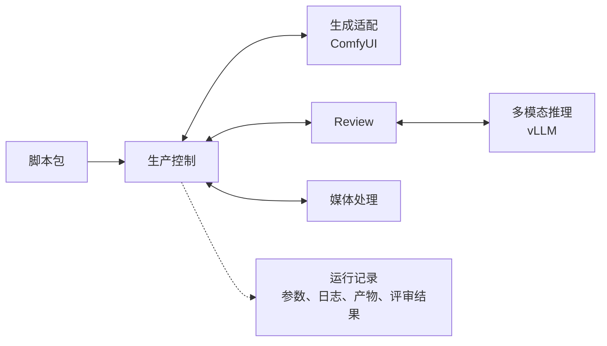

<!--
<document version="0.3.0" updated_at="2026-10-30" keywords="模块架构,ComfyUI,vLLM,Review" />
-->

# 模块架构

视频生成使用 [ComfyUI](https://github.com/Comfy-Org/ComfyUI)，Review 模型推理使用 [vLLM](https://github.com/vllm-project/vllm)。两者采用独立运行环境，通过本地或内网接口调用。

| 模块 | 职责 |
| --- | --- |
| 生产控制 | 组织镜头任务、执行顺序与并发、返工和人工审核衔接 |
| 生成适配 | 选择 ComfyUI workflow、映射生成参数、提交和查询任务 |
| Review | 结合原始镜头要求、参考素材与抽帧，只输出画面判断、问题位置和警告，无权修改提示词 |
| 多模态推理 | 使用 vLLM 部署评审模型并完成推理 |
| 媒体处理 | 选中片段逐片超分、保留原音轨与实测时长、统一格式后拼接与最终编码 |
| ASR 与字幕 | 可选的成片转写、时间戳与字幕对齐；剧本差异只报警，不触发重生成 |
| 运行记录 | 关联参数、日志、产物和评审结果，支持复盘 |

生产控制的顺序是：生成 take → 画面审核或记录降级选择 → 单片超分 → 全部片段就绪后拼接 → 可选 ASR、差异报告与字幕 → 人工成片终审 → 最终编码。画面明确不通过时，最多生成 3 个自动 take；预算耗尽或审核不可用时随机选已有可用 take 继续。提示词和素材绑定由上游冻结，重做只换 seed；没有自动整片重审返工循环。

实现仍使用 Python 单进程编排，在 `pipeline.py` 内协调生成与审核两个线程池。B200 配置中 GPU0–6 的七个 ComfyUI 实例承担生成和超分，同一实例的任务互斥；镜头等待审核时释放生成实例。GPU7 是一张完整 B200，运行多并发 Qwen 审核和可选 ASR 进程，共享显存预算；字幕文件处理使用 CPU。具体模型显存与并发需在节点上测量。

每次运行的状态保存在 JSON，事件写入 JSONL，媒体与推理环境独立存放。普通续跑不重置预算；人工显式新制作轮保留累计尝试编号。无需额外编排服务、数据库或独立调度器模块，也不支持多个控制进程同时写入同一运行目录。
