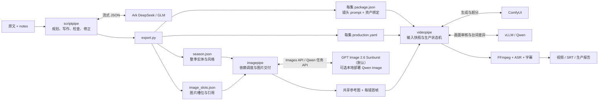
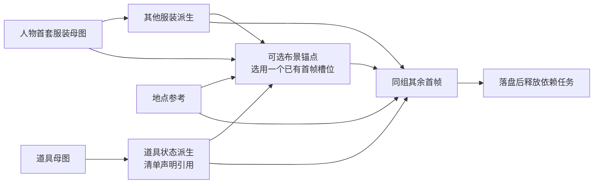
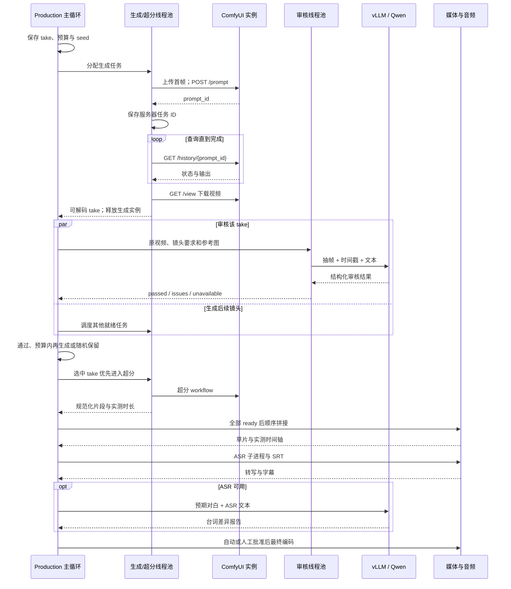

# 模块与协作

## 文件连接三个生产模块

三个 CLI 独立启动，共享磁盘文件。`storyboard.json` 保存导出的结构化分镜；图片执行器实际读取图片清单和季风格，视频执行器读取编译后的镜头包。

## 代码定位

| 入口 / 模块 | 负责什么 |
| --- | --- |
| [scriptpipe/cli.py](../scriptpipe/cli.py) | 选择短剧 / 长剧，注入原文、notes、集数、并发和导出配置 |
| [pipeline.py](../scriptpipe/pipeline.py)、[long_pipeline.py](../scriptpipe/long_pipeline.py) | 短剧按集写；长剧按场写，先分集再整季审核；缓存中间结果并合并局部补丁 |
| [checks.py](../scriptpipe/checks.py)、[long_checks.py](../scriptpipe/long_checks.py) | ID / 引用、对白、语言、动作字段、场次与镜头分配、计划时长检查 |
| [llm.py](../scriptpipe/llm.py) | LLM 流式请求、并发信号量、JSON 解析、请求/响应/用量记录与技术重试 |
| [export.py](../scriptpipe/export.py) | 编译 H3 prompt、人物与资产 ID，导出单集包、图片清单和整季索引 |
| [batch.py](../scriptpipe/batch.py) | 按集复制剧本和实际图片，保留全剧设定，生成可独立交接的批次包 |
| [imagepipe/plan.py](../imagepipe/plan.py)、[models.py](../imagepipe/models.py) | 统一单集 / 整季槽位，计算引用依赖，选模板、模式、seed 与路径；检查循环和缺失引用 |
| [imagepipe/pipeline.py](../imagepipe/pipeline.py) | 等待依赖、控制在途任务数、保存 GPT 原图/request ID/usage 或 Qwen job ID、续跑、共享图复制与报告 |
| [imagepipe/client.py](../imagepipe/client.py)、[delivery.py](../imagepipe/delivery.py) | GPT 生成/编辑与 Qwen 提交/轮询/下载；API 原文件复制交付 |
| [videopipe/inputs.py](../videopipe/inputs.py)、[models.py](../videopipe/models.py) | 输入字段、文件与 API workflow 校验；复制素材、自定义 workflow 和配置，冻结运行 prompt |
| [videopipe/pipeline.py](../videopipe/pipeline.py) | `Production` 状态机、两个线程池、生成预算、选片、超分、拼接、批准与交付 |
| [backends/comfyui.py](../videopipe/backends/comfyui.py)、[backends/review.py](../videopipe/backends/review.py) | ComfyUI 参数填充和任务恢复；Qwen 请求与结果解析。CPU 后端供本地流程验证 |
| [media.py](../videopipe/media.py)、[backends/asr.py](../videopipe/backends/asr.py)、[subtitles.py](../videopipe/subtitles.py) | 媒体处理、隔离 ASR 子进程、对白提取与字幕对齐 |
| [season.py](../videopipe/season.py)、[delivery.py](../videopipe/delivery.py)、[records.py](../videopipe/records.py) | 逐集编排、收集交付、状态文件与事件日志 |

## 图片依赖与请求

每个任务保存最终 prompt、模式、有序参考 ID、seed 和目标路径。无参考走文生图；单参考的服装/道具派生走编辑；其他有参考的任务走参考生成。最多 10 张参考，上传顺序对应模板内的图片编号。`continuity.sets` 定义布景锚点，`additional_reference_assets` 补充引用；按作品数据设置。

默认 HTTP 并发 16，在途窗口 64，轮询间隔 5 秒。窗口从提交前持续占用到落盘，任务不等待同一层全部完成。接口是 `/v1/images/jobs`、`/edits`、`/references`；查询使用 `/v1/images/jobs/{id}` 和 `/results`。请求宽高向上对齐 32 像素；默认请求及交付均为 736×1280，原图另存。

## 视频服务协作时序

B200 配置使用 7 个生成 worker、6 个审核 worker。生成与超分通过实例队列互斥占用 ComfyUI；每个审核请求独立持有 HTTP 客户端与输出目录。主循环更新生产状态；同一运行目录由一个控制进程写入。

## 配置、模板与数据的归属

| 文件 | 谁读取 | 决定什么 |
| --- | --- | --- |
| [configs/imagepipe.yaml](../configs/imagepipe.yaml)、[imagepipe_qwen.yaml](../configs/imagepipe_qwen.yaml) | `imagepipe run --provider gpt\|qwen` | GPT 默认质量/原生尺寸、Qwen 步数、请求尺寸、任务并发和可选引用补充 |
| [configs/b200.yaml](../configs/b200.yaml) | `videopipe`；`scriptpipe` 默认导出基底 | ComfyUI 实例、Qwen、ASR、媒体输出和视频预算 |
| [configs/cpu.yaml](../configs/cpu.yaml) | `videopipe` | CPU 预览与技术审核，验证流程用 |
| 导出的 `production.yaml` | 每集视频运行 | 从选定基底复制，并由 exporter 写入 576×1024、24fps；超分等其余参数保留 |
| [prompt/](../prompt/README.md) | 三个模块 | 可复用生产模板；作品原文、设定和具体镜头内容经数据传入 |

YAML 只覆盖对应 Python 配置模型的默认值，配置文件之间没有自动继承。`scriptpipe` 的创作参数来自 CLI 和代码里的 brief；`--production-config` 用于导出视频配置，不控制剧本写作或图片生成。

输入保存方式有区别：剧本复用阶段文件；图片将最终任务与配置写入 `tasks.json` 并依赖包内资产路径；视频复制输入到自身运行目录。修改外部配置后，已有图片 / 视频运行仍读取已保存的配置。具体文件和续跑入口见 [使用](usage.md)。
