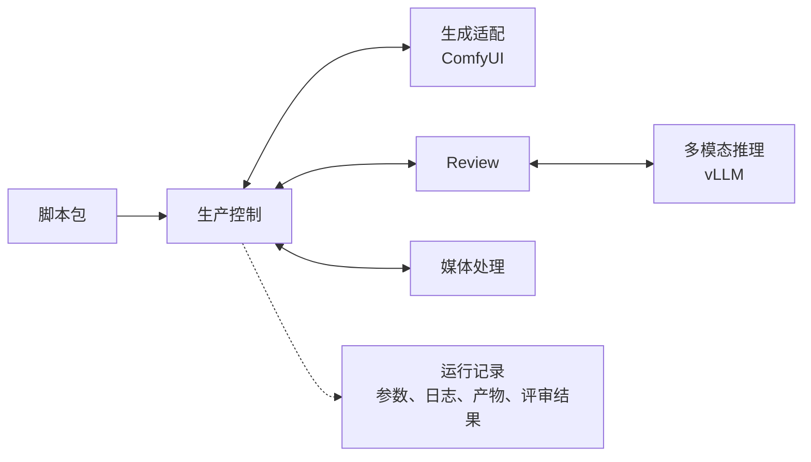

<!--
<document version="0.2.0" updated_at="2026-10-28T21:51:26+08:00" keywords="模块架构,ComfyUI,vLLM,Review" />
-->

# 模块架构

视频生成使用 [ComfyUI](https://github.com/Comfy-Org/ComfyUI)，Review 模型推理使用 [vLLM](https://github.com/vllm-project/vllm)。两者采用独立运行环境，通过本地或内网接口调用。

| 模块 | 职责 |
| --- | --- |
| 生产控制 | 组织镜头任务、执行顺序与并发、返工和人工审核衔接 |
| 生成适配 | 选择 ComfyUI workflow、映射生成参数、提交和查询任务 |
| Review | 结合剧本、参考素材和视频，输出评审结果、问题位置与修复建议 |
| 多模态推理 | 使用 vLLM 部署评审模型并完成推理 |
| 媒体处理 | 剪辑合并、超分与最终编码 |
| 运行记录 | 关联参数、日志、产物和评审结果，支持复盘 |

生产控制根据评审结果决定下一步。生产流程与 ComfyUI 节点图分开管理，模型和 ComfyUI workflow 支持通过配置更换。

初版使用 Python 单进程编排，以线程池并发调用多个独立 ComfyUI 实例。每次运行的状态保存在 JSON，事件写入 JSONL，媒体与推理环境独立存放。无需额外编排服务或数据库。
