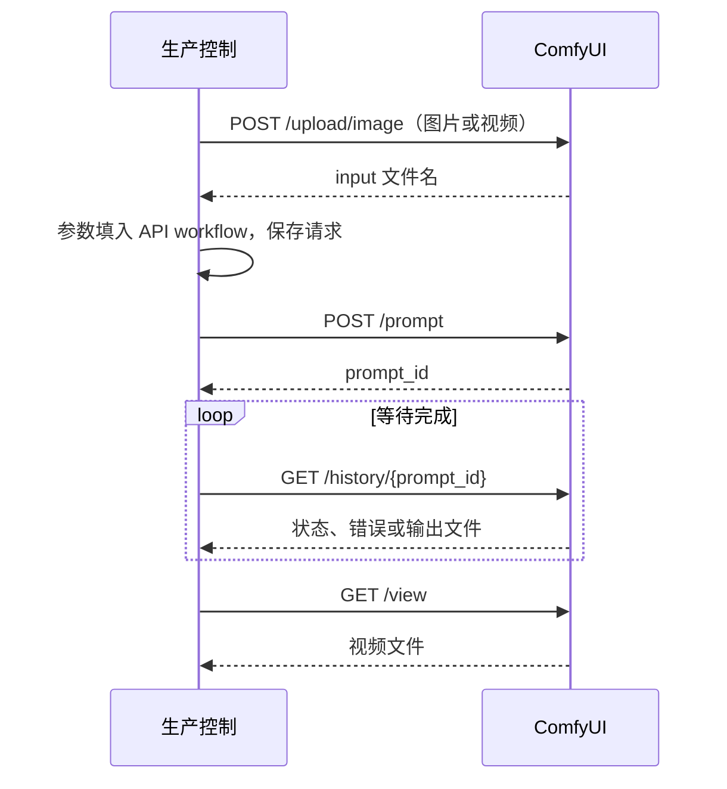

<!--
<document version="0.2.0" updated_at="2026-10-28T21:34:14+08:00" keywords="ComfyUI,H3,workflow,超分,接口" />
-->

# ComfyUI 接入

使用 ComfyUI 原生 H3 与媒体节点，不需要第三方节点或云端 MiniMax API。ComfyUI 独立部署，本项目通过 HTTP 上传素材、提交任务、轮询结果和下载 MP4。

## Workflow 与参数

| 模板 | 用途 |
| --- | --- |
| `videopipe/workflows/h3_t2v.json` | H3 文生视频，包含原生音频 |
| `videopipe/workflows/h3_i2v.json` | 第一张参考图作为首帧，生成音视频 |
| `videopipe/workflows/upscale.json` | 原生超分模型处理视频帧，保留输入帧率和音频 |

未配置 `comfyui.workflow` 时，有参考图自动选 I2V，否则选 T2V。自定义模板必须是 ComfyUI **API 格式**，可用配置切换。内置 JSON 随 Python wheel 打包，由 `python scripts/build_workflows.py` 生成，修改生成脚本后重新生成。

占位符必须占满字符串，例如 `"{{steps}}"`，替换后保留整数、列表等类型。支持 `prompt`、`negative_prompt`、`width`、`height`、`fps`、`frames`、`duration`、`seed`、`attempt`、`feedback`、`filename_prefix`。上传素材提供 `reference_image`、`reference_image_0` 等索引名称和 `reference_images` 列表；超分提供 `reference_video`、`factor`。

默认参数先由 `comfyui.parameters` 覆盖，再由镜头 `parameters` 覆盖。返工默认使用 `seed + attempt - 1`。H3 模板采用 `BasicGuider`，没有独立负面条件输入，因此 `h3_prompt` 将正面提示、`Avoid:` 负面约束和返工反馈合并为自然语言。

H3 使用 24fps，尺寸为 32 的倍数，帧数向上对齐到 `17k+5`；5 秒对应 124 帧。生成长度与请求时长的差异由后续剪辑处理。默认 I2V 只使用第一张参考图；其余参考图可通过自定义 API workflow 的索引占位符接入，不能把首帧模式视为多参考身份保持模式。

## 本地模型

以下为内置默认值，均可通过 `comfyui.parameters` 更换。

| 参数 | ComfyUI 目录 | 文件 |
| --- | --- | --- |
| `diffusion_model` | `models/diffusion_models/` | `minimax_h3_fl2va_pruned_int8_convrot.safetensors` |
| `text_encoder` | `models/text_encoders/` | `qwen3vl_32b_minimax_h3_nvfp4_awq.safetensors` |
| `video_vae` | `models/vae/` | `minimax_h3_video_vae_int8_convrot.safetensors` |
| `audio_vae` | `models/vae/` | `minimax_h3_audio_vae_fp32.safetensors` |
| `upscale_model` | `models/upscale_models/` | `RealESRGAN_x2plus.pth` |

H3 默认 `steps=20`、`sampler=res_multistep`、`scheduler=simple`，不要求额外 LoRA。H3 权重来自 [Comfy-Org/MiniMax-H3](https://huggingface.co/Comfy-Org/MiniMax-H3)；超分权重来自 [Real-ESRGAN v0.2.1](https://github.com/xinntao/Real-ESRGAN/releases/tag/v0.2.1)。超分先按模型倍率推理，再调整到配置要求的尺寸。

## 运行记录与验证边界

`/upload/image` 的名称不限制图片类型：[上游上传实现](https://github.com/Comfy-Org/ComfyUI/blob/79cf64c21a1dba50749945ba9fe2e3a692f45438/server.py#L467)将 multipart 的 `image` 字段原样写入 input 目录，不要求图像解码。本适配上传视频时使用同一路由和 `video/mp4` MIME，随后将服务端返回文件名交给 `LoadVideo`；测试覆盖上传字节和文件名传递。

每次尝试保存 `parameters.json`、`workflow.json`、`request.json`、`submission.json`、`prompt.json`、`history.json` 和视频。提交校验错误与执行错误直接报告；超时保留任务 ID，不自动重提，也不取消服务器正在执行的任务。

HTTP 契约测试运行真实本地服务，覆盖素材上传、参数填充、轮询、MP4 下载、执行错误、提交错误和超时。测试视频由 FFmpeg 编码并验证可解码，测试服务不执行神经网络；GPU 兼容性和画质需在后续机器上验证。

内置超分流程一次读取整段视频并逐帧使用图像超分模型，没有时序一致性模型。长片的内存占用及闪烁表现需在实际素材上评估；当前用于短片初版。

## 上游依据

2026-10-28 核对 ComfyUI `79cf64c21a1dba50749945ba9fe2e3a692f45438` 与官方模板 `bf26c7cfc3ce7e370edf6ade2cd9ea88f6b51ec0`，前者当日仍有更新。采用原生节点可复用既有采样、媒体解码和模型加载逻辑，避免另加包装节点及其依赖。

| 项目 | 依据与边界 |
| --- | --- |
| ComfyUI | [H3 节点源码](https://github.com/Comfy-Org/ComfyUI/blob/79cf64c21a1dba50749945ba9fe2e3a692f45438/comfy_extras/nodes_minimax_h3.py)、[视频节点](https://github.com/Comfy-Org/ComfyUI/blob/79cf64c21a1dba50749945ba9fe2e3a692f45438/comfy_extras/nodes_video.py)；GPL-3.0，独立服务运行，本项目未复制其实现 |
| 官方模板 | [H3 API 基准图](https://github.com/Comfy-Org/workflow_templates/blob/bf26c7cfc3ce7e370edf6ade2cd9ea88f6b51ec0/benchmarks/video_minimax_h3_t2v.json)；MIT，内置图参考其原生节点连接方式，保留[许可](../videopipe/workflows/THIRD_PARTY_LICENSES.md) |
| H3 权重 | [MiniMax H3 Community License](https://huggingface.co/MiniMaxAI/MiniMax-H3/blob/main/LICENSE)，属于自定义模型许可，商业使用按该许可办理 |
| Real-ESRGAN | [官方源码与许可](https://github.com/xinntao/Real-ESRGAN)，BSD-3-Clause；只使用既有权重，由 ComfyUI 加载，无需安装其旧版推理依赖 |

[官方 H3 指南](https://docs.comfy.org/tutorials/video/minimax/minimax-h3)记录的实际兼容问题：INT8 ConvRot 权重不支持 Comfy Kitchen attention，部分全量模型 LoRA 与 pruned 权重不匹配。因此初版保留默认 attention 和基础模型，不启用这些优化。
