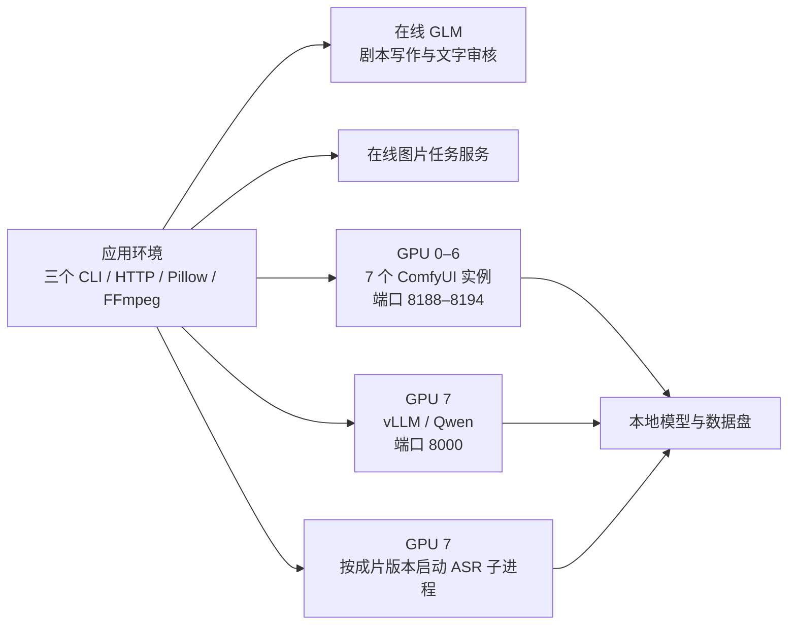

# 运行环境与部署

## 服务分工



| 环境 | 内容与入口 |
| --- | --- |
| 应用 `.venv` | 仓库 Python 包；需要转写时安装 `.[asr]`。FFmpeg 随应用依赖提供 |
| 外部 ComfyUI | 独立 Python / PyTorch 环境；[start-comfyui.sh](../deploy/start-comfyui.sh) 指向已有安装 |
| 外部 vLLM | 独立推理环境；[start-vllm.sh](../deploy/start-vllm.sh) 启动本地审核模型 |
| 数据盘 | 模型、项目输入、运行记录、输出与编译缓存；通过配置和环境变量指定路径 |

`configs/b200.yaml` 是当前 8 卡拓扑。单机或其他设备通过自己的运行配置调整 URL 和 worker 数；生成 worker 数不能超过 ComfyUI URL 数量。`configs/cpu.yaml` 使用参考图预览与技术审核，不加载 GPU 模型。

## 模型与 workflow

内置图由 [scripts/build_workflows.py](../scripts/build_workflows.py) 生成，输出到 [videopipe/workflows/](../videopipe/workflows/)：`h3_t2v.json`、`h3_i2v.json`、`upscale.json`。使用原生 H3 和媒体节点。

| 用途 | 默认模型文件 / 目录 |
| --- | --- |
| H3 diffusion | `models/diffusion_models/minimax_h3_fl2va_pruned_int8_convrot.safetensors` |
| H3 text encoder | `models/text_encoders/qwen3vl_32b_minimax_h3_nvfp4_awq.safetensors` |
| H3 video VAE | `models/vae/minimax_h3_video_vae_int8_convrot.safetensors` |
| H3 audio VAE | `models/vae/minimax_h3_audio_vae_fp32.safetensors` |
| 超分 | `models/upscale_models/RealESRGAN_x2plus.pth` |
| 视觉审核 | 本地完整 `nvidia/Qwen3.8-Flash-Next-NVFP4`，含 tokenizer / processor；服务别名 `qwen-review` |
| ASR | 本地 faster-whisper `large-v3` 目录或完整缓存；配置也接受本地绝对路径 |

H3 默认 10 步、`res_multistep` / `simple`，24fps，帧数向上对齐 `17k+5`；5.875 秒正好 141 帧。参数优先级是内置默认 → `comfyui.parameters` → 镜头 `parameters`。实际文本、尺寸、seed 和素材由专门输入字段控制。H3 的 `BasicGuider` 使用已冻结的完整文本。

自定义图须是 ComfyUI API 格式。`{{name}}` 占位符占满字符串时保留替换值类型；生成可用 `prompt`、`h3_prompt`、尺寸、帧数、seed、上传首帧等，超分使用 `reference_video`、`factor`。具体映射以 [ComfyGenerator](../videopipe/backends/comfyui.py) 为准。每次生成保存实际参数、填充图、提交和服务器历史，超时后可按已知 `prompt_id` 继续。

仓库接入记录采用 ComfyUI `79cf64c21a1dba50749945ba9fe2e3a692f45438`；vLLM 启动脚本记录了所需兼容实现提交 `d4d703caf908786416585ceb1f369e2e0363358b`。部署时随环境保存实际 wheel、模型 revision 与校验值。上游节点图来源及许可见 [THIRD_PARTY_LICENSES.md](../videopipe/workflows/THIRD_PARTY_LICENSES.md)；H3 权重及其许可见 [模型仓库](https://huggingface.co/Comfy-Org/MiniMax-H3)，超分权重见 [Real-ESRGAN 发布页](https://github.com/xinntao/Real-ESRGAN/releases/tag/v0.2.1)。

## 启动服务

每个 ComfyUI 实例指定自己的 GPU、端口和输入/输出目录。以下启动第一个实例；其余依次使用 GPU 1–6、端口 8189–8194。

```bash
COMFYUI_DIR=/mnt/video-runtime/ComfyUI COMFY_GPUS=0 COMFY_PORT=8188 \
COMFY_INPUT_DIR=/mnt/video-data/comfy-0/input COMFY_OUTPUT_DIR=/mnt/video-data/comfy-0/output \
  bash deploy/start-comfyui.sh

PATH=/mnt/video-runtime/vllm/bin:$PATH \
QWEN_MODEL_PATH=/mnt/video-models/Qwen3.8-Flash-Next-NVFP4 \
REVIEW_GPUS=7 REVIEW_TP=1 REVIEW_GPU_MEMORY=0.80 \
REVIEW_CONTEXT=65536 REVIEW_MAX_SEQS=6 \
FLASHINFER_WORKSPACE_BASE=/mnt/video-cache/vllm \
  bash deploy/start-vllm.sh
```

Qwen 启动参数包括 `modelopt` 量化、CPU embedding offload、TP1、64K context 和并发 6；`review.workers` 默认也为 6。审核采用非思考模式、温度 0、结构化 JSON，默认 48 张抽帧、最长边 1024，再加参考图；`REVIEW_MAX_IMAGES` 需容纳总图片数。已有作品包的显式配置优先于代码默认值；需要保留原包时，复制运行配置、调整审核参数，通过 `run-season --config` 指定。已有运行继续读取保存的配置快照，新参数使用新的输出目录。

GPU7 同时容纳常驻 vLLM 和阶段性 ASR。ASR 默认 `gpu: 7`、`compute_type: int8_float16`、超时 600 秒，模型从本地读取；显存分配和并发根据目标节点的峰值用量调整。缺少 ASR 依赖、模型或运行库时报告 `unavailable`，继续字幕粗对齐和交付。

## 离线应用包

```bash
# 在线准备机：按 requirements.lock 收集应用依赖，并构建三个 CLI 所在的 wheel
.venv/bin/python scripts/export_bundle.py --output /mnt/releases/videopipe-app.tar.gz

# 离线节点：使用相同 Linux 架构和 Python 小版本
mkdir -p /mnt/video-app
tar -xzf /mnt/releases/videopipe-app.tar.gz -C /mnt/video-app
cd /mnt/video-app/videopipe
python3 -m venv .venv
.venv/bin/python -m pip install --no-index --find-links wheelhouse videopipe
```

应用包包含三个模块、生产模板、配置、部署脚本、文档、测试及应用 wheelhouse。原始素材、作品包、历史运行、GPU 环境和模型单独准备。

GPU 依赖在对应外部环境中固定：ComfyUI 的 PyTorch/CUDA 组合，vLLM wheel 及其依赖、FlashInfer kernels，以及应用 ASR 的 faster-whisper/CTranslate2 运行库。在线侧构建各自 wheelhouse、下载完整模型，离线侧重建环境后启动服务；启动脚本开启离线模式。生产命令见 [使用](usage.md)。
