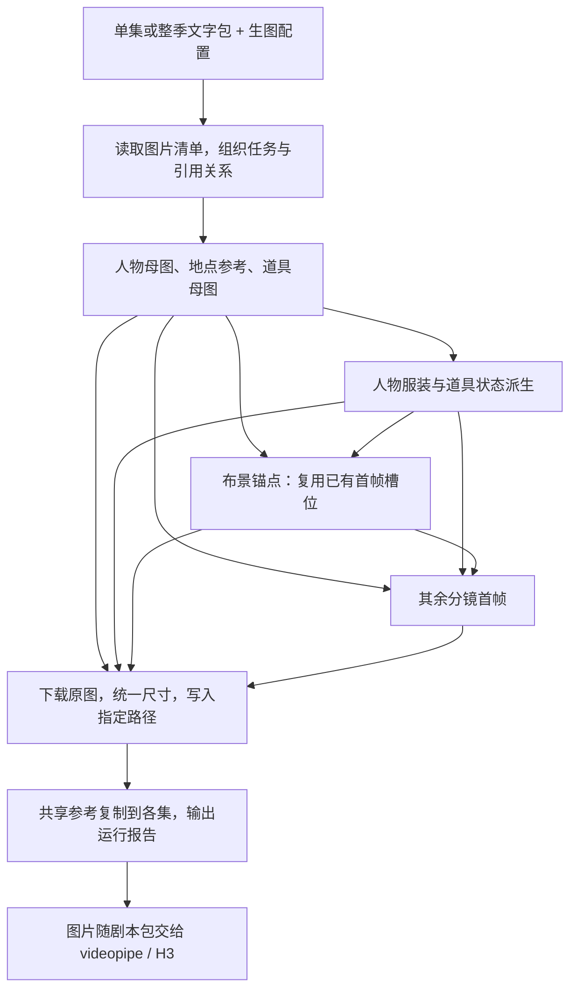

<!--
<document version="0.2.0" updated_at="2026-11-01" keywords="imagepipe,批量生图,剧本包,ComfyUI,PRO6000,规划" />
-->

# imagepipe：通用剧本包批量生图设计

**已实现独立 CLI，并完成珍珠衫整季补图。** 支持不同长度的单集和整季剧本包；实际进度与错误见运行目录的 `state.json`、`events.jsonl` 和 `report.json`。

## 1. 输入与产物

imagepipe 读取已有文字和图片槽位，生成共享参考与每镜首帧，直接写入剧本包指定的路径。集数、镜头数、人物、服装和场景由数据决定，不写死在代码中。

| 输入 | 用途 |
| --- | --- |
| `image_slots.json` | 资产 ID、目标路径、英文描述、参考关系；决定生成哪些图、复制哪些图 |
| `season.json`（整季包） | 全季风格、人物、服装、地点与道具设定 |
| `storyboard.json`（单集） | 镜头归属、场景、时间及开场构图 |
| `package.json`、`production.yaml` | 保留既有 H3 输入与视频配置；图片落到已有绑定路径 |
| `imagepipe.yaml` | 生图服务、生成参数、并发及可选的资产／布景引用补充 |

单集的 `slots` 与整季的 `shared_assets`、`first_frames` 统一转成同一种任务列表。单集引用包外的共享资产时沿用已有来源路径；新剧本沿用这套图片清单即可接入，不要求固定目录名或固定集长。只有 `script.md` 的纯文本需先经过上游导出图片清单，imagepipe 不重新创作剧本。

珍珠衫样例已补齐 **747 张**：48 张人物服装图、13 张地点图、14 张道具图、672 张首帧；另完成 **126 次共享图本地复制**。这些是本次输入的统计，不是执行器限制。

运行由 imagepipe 独立推进。agent 只负责开发、debug 和事后复盘；运行中不 review、不挑图、不改 prompt、不换参考图。每个槽位生成一张，不设置人工批准或视觉评分循环。

## 2. 流程



图表示依赖顺序。每张图落盘后，立即释放依赖它的任务，不等待上一整批完成；没有派生图或布景锚点的剧本直接跳过对应步骤。共享参考优先提交，尽早释放分镜任务。

## 3. 一致性与 prompt

- **人物**：按清单顺序选每个人物的第一套服装槽位作为母图；其他服装从同一母图派生，镜头引用对应服装图。母图要求单人、面部与衣着清晰，不新增候选图筛选。三视图可作为未来清单中的独立参考资产接入，不把拼图交给 H3 当首帧。
- **道具**：完整、破损等状态沿用清单中的参考关系生成；穿戴物与道具需要一致时，通过数据补充引用，不在代码中特判珍珠衫等具体物品。
- **场景**：全季复用地点母图。明确属于同一布景的镜头，可复用其中一张首帧作为固定锚点；锚点从共享参考生成，其余镜头引用锚点，不用上一张结果逐镜串联。同一布景的不同时间可各用一张已有首帧固定光照，不增加槽位。
- **布景归属**：`location_id` 可能包含多个房间，`scene_id` 也可能包含室内外转移，不能直接等同于物理空间。需要跨集固定房间时，在生图配置中用 `set_id`、镜头列表和 `anchor_shot` 指定对应关系；未分组的镜头使用地点参考与自身描述。映射是数据，不新增必需的连续性文件。
- **首帧**：组合当前人物、服装、地点、道具与可用锚点，描述镜头零秒的完整画面。参考图按固定顺序上传，prompt 逐项说明各图对应什么、应保留什么；场景锚点仅用于环境，出场人物以当前分镜为准。

所有模板放在 `prompt/imagepipe/*.txt`，使用英文。内容由统一风格、当前槽位描述、有序参考说明和首帧构图直接拼接，不在运行中调用 LLM 改写。中文对白和 H3 视频 prompt 保持原样，不将整集剧本或对白当成生图提示。

上述方法利用固定参考降低漂移，不能保证模型严格保持身份与空间。seed 记录在任务中用于复现，不能代替参考图。

## 4. 参数、接口与并发

本次统一使用 **标准版 `qwen-image-2.1`、20 步、720×1280、9:16**，包括人物、场景、道具和首帧。其他剧本可通过配置修改尺寸与生成参数。

默认配置 `configs/imagepipe.yaml`：

```yaml
api:
  base_url: https://api.zlk7301.com
  env_file: .env
  key_name: QWEN-IMAGE
generation:
  model: qwen-image-2.1
  steps: 20
  width: 720
  height: 1280
  seed_base: 20261101
scheduler:
  http_concurrency: 16
  max_active_jobs: 64
  poll_interval_seconds: 5
```

每个资产一个 `n=1` 任务。程序持续补充依赖就绪的任务，最多保持 64 个尚未完成落盘的远端任务；上传、查询和下载共用 16 个 HTTP 并发。单卡 PRO6000 的实际推理由服务端排队执行，客户端并发用于覆盖网络等待，不代表同时推理 64 张。以上是初始配置；实际吞吐与排队情况写入日志和最终报告，供事后调参。

采用已跑通的接口：无参考图使用 JSON `POST /v1/images/jobs`，单图编辑使用 multipart `POST /v1/images/edits`，多参考生成使用 multipart `POST /v1/images/references`。文件字段为重复的 `image`，上传顺序对应 prompt 中的图片序号；通过 `/v1/images/jobs/{id}` 及其 `/results` 轮询和下载。第一版只实现文件上传，参考图数量遵循服务的 1～10 张约定。

服务任务持久排队，客户端断开不会取消。提交后保存 `job_id`；恢复时继续查询和下载已知任务，已完成的图直接复用。错误记录到运行目录，独立任务继续；技术重试沿用原任务参数，不因视觉效果重抽。

**已实测的尺寸约束**：API 要求请求宽高为 32 的倍数，720×1280 直接提交会返回 422。客户端向上取整，请求 736×1280；交付仍为 720×1280。参考模式还可能跟随第一张输入图的比例。正式参考统一使用竖屏；下载后保留原图，并用 Pillow 等比缩放、居中裁切到配置尺寸，保存 RGB PNG，处理后的图用于后续引用。尺寸已经符合时不重采样，原始尺寸与处理结果写入记录。

## 5. 代码与使用方式

沿用仓库的 Python、argparse、asyncio、httpx、Pydantic、PyYAML、Pillow 与 JSON 文件，不引入数据库或新队列服务。

```text
imagepipe/
├── __init__.py
├── __main__.py
├── cli.py          # run / resume / status
├── models.py       # 配置、任务、运行状态
├── plan.py         # 统一单集/整季清单，组织依赖与最终 prompt
├── client.py       # 提交、查询、下载
├── pipeline.py     # 就绪任务、并发窗口、落盘后推进、续跑
└── delivery.py     # 尺寸处理、图片写入、共享参考复制、运行报告
prompt/imagepipe/
├── character_master.txt
├── wardrobe_edit.txt
├── location_reference.txt
├── prop_reference.txt
├── prop_edit.txt
└── first_frame.txt
```

任务只需资产 ID、模式、prompt、有序参考 ID、seed 和目标路径；引用关系同时表达依赖。任务与进度分开保存，进度记录状态、远端 job ID、文件路径和错误。seed 按输入顺序加 `seed_base` 分配，恢复时沿用记录。

`pipeline.run()` 表达读取任务 → 提交就绪任务 → 查询结果 → 下载落盘 → 推进依赖的正常流程。外部数据在入口解析一次，内部传明确类型；细节放到对应模块，不逐层重复检查，不预建插件或多后端框架。

安装与运行：

```bash
python -m pip install -e .

imagepipe run examples/pearl_shirt_long \
  --config configs/imagepipe_pearl_shirt_long.yaml --output runs/imagepipe/pearl_shirt_long

imagepipe resume runs/imagepipe/pearl_shirt_long
imagepipe status runs/imagepipe/pearl_shirt_long
```

`run` 直接组织任务并执行，无需单独 plan 或 approve。单集输入使用同一命令。以后 scriptpipe 可调用相同的 Python 入口，本轮只设计独立运行。

运行目录保留 `tasks.json`（最终参数、prompt、引用）、`state.json`（进度与 job ID）、`events.jsonl`、`originals/` 和 `report.json`（生成／复制数量、耗时、错误）。直接依据路径与运行状态复用产物，不使用内容哈希、签名、审批、交付门禁或额外的检查阶段。

CLI 与模板资源已在 `pyproject.toml` 注册。珍珠衫专用配置补充了 5 个布景锚点和珍珠衫服装的道具引用；其他剧本使用默认配置并按自身文字添加引用。自动导出的剧本文件不手改；若要扩展清单字段，修改 `scriptpipe/export.py` 后重新导出。

## 6. 已有证据与 H3 交接

此前已跑通标准版 40 步文生图、Turbo 8 步单图编辑、标准版 40 步双参考生成。此次三条路径均以标准版 20 步成功生成，PNG workflow 确认实际权重和步数。文生图原图为 736×1280；编辑和多参考原图为 704×1280，均交付为 720×1280。

本次完整 CLI 于 2026-11-01 14:45–17:01（UTC+8）自主运行并正常退出，耗时 **2 小时 16 分 37 秒**，新生成 746 张、复用同参数正式接入测试的 1 张，平均 **5.461 张/分钟**（含排队、轮询、下载与落盘）。生成失败与重提交均为 0，126 次复制完成。现有 `videopipe.inputs.load_package` 成功读取全部 8 集，672 个首帧和 126 个集内参考路径均存在。结果见运行目录的 `report.json`、`benchmark.json`、`handoff.json`；没有进行视觉 review。

记录见本地 [API 测试与尺寸对照](../runs/qwen_image_inputs_20261101/probe_report.json)；`runs/` 不随 Git 提交。参考依据：[Qwen 官方说明](https://github.com/QwenLM/Qwen-Image-2.1/blob/main/README.md)、[ComfyUI 官方生成与编辑流程](https://docs.comfy.org/tutorials/image/qwen/qwen-image-2-1)。

H3 当前只读取每镜 `first_frame` 作为图像条件，`review_only` 图用于后续视频分镜审核。因此 imagepipe 必须把人物、场景和道具组合进实际首帧，随后按现有清单复制各集参考。完成数量与错误写入运行报告，不增加 `ready` 门禁，也不手改导出文件里的状态快照。

720×1280 是图片交付尺寸；现有 H3 视频仍为 576×1024、24fps、10 步。补图不修改视频参数，也不启动视频。当前仓库已另行提供 `videopipe run-season`，使用方式见[整季运行说明](season-delivery.md)；本次只完成图片生成与输入加载，未执行 H3 视频生成。

必要本地测试覆盖真实 HTTP 编码、尺寸处理、依赖顺序、共享复制与续跑复用。运行记录位于 `runs/imagepipe/pearl_shirt_long/`；`agent_log.md` 记录技术报错和修复，`console.log` 保存 CLI 输出。prompt 官方依据见 [模板说明](../prompt/imagepipe/README.md)。
