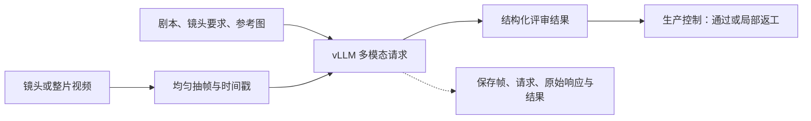

<!--
<document version="0.2.0" updated_at="2026-10-28T20:30:00+08:00" keywords="Review,vLLM,Qwen,抽帧,CPU验收" />
-->

# 视频 Review

Review 使用独立 vLLM 服务，默认模型别名为 `qwen-review`，基线权重为 [Qwen3-VL-8B-Instruct](https://huggingface.co/Qwen/Qwen3-VL-8B-Instruct)。模型可替换，CPU 开发环境不下载或部署权重。[Qwen3-VL](https://github.com/QwenLM/Qwen3-VL) 与 [vLLM](https://github.com/vllm-project/vllm) 为持续维护的上游项目，代码及所选权重均标注 Apache-2.0；业务代码只调用服务。



## 输入与结果

每段视频分成 `sample_frames` 个时间区间，在区间中点取帧；默认 8 帧，最长边 640 像素。帧按播放顺序附时间戳，与剧本、正负 Prompt、验收要求和各镜头参考图一起通过本地 Base64 图片传入 `/v1/chat/completions`。服务不访问公网素材。

结果包含 `passed`、`summary`、`issues`；每项问题记录 `shot_id`、`category`（生成或剪辑）、`message`、可选的替换 `suggested_prompt`。整片剪辑问题可不指定镜头；生成问题必须指定存在的镜头。输出在适配器入口校验一次。请求失败、截断、非 JSON、无问题说明的拒绝或未知镜头编号均报错并留下原始响应，不算审核通过。

调用使用 vLLM 的 [`structured_outputs.json`](https://docs.vllm.ai/en/stable/features/structured_outputs/) 约束格式，未使用已弃用的 `guided_json`。每次评审保存 `frames/`、`request.json`、`response.txt`、`result.json`；服务或解析错误另存 `error.txt`。

## 实现取舍

| 方式 | 依赖与收益 | 限制 |
| --- | --- | --- |
| 带时间戳的图片序列（当前） | 使用 vLLM 官方多图输入；FFmpeg 在业务侧抽帧，帧与请求可直接复盘 | 稀疏采样可能漏掉短暂缺陷，不等同完整视频理解 |
| 直接视频输入 | Qwen/vLLM 支持视频输入，可利用模型的视频处理路径 | 服务侧增加视频解码与采样配置，GPU 上需验证具体版本和采样策略 |

取舍依据为 [vLLM 多模态输入说明](https://docs.vllm.ai/en/stable/features/multimodal_inputs/) 和 [Qwen 官方部署示例](https://github.com/QwenLM/Qwen3-VL#deployment)。本版不评估音频，也不把少量静帧判定为动作流畅性的证明。整片评审抽帧数量可调；逐镜头评审负责更细的覆盖。

## 部署与 CPU 验收

在线准备完整模型目录和独立 vLLM 运行环境，放入挂载盘。Qwen 官方要求支持 Qwen3-VL 的 vLLM 版本（至少 0.11.0）；本项目使用现行结构化输出字段，部署时固定实际安装版本并保留环境记录。

```bash
QWEN_MODEL_PATH=/mnt/models/Qwen3-VL-8B-Instruct \
REVIEW_GPUS=0 bash deploy/start-vllm.sh
```

`REVIEW_GPUS` 指定可见卡，`REVIEW_TP` 指定张量并行数；默认单卡。`REVIEW_MAX_IMAGES` 必须容纳抽帧和参考图总数；上下文或显存不足时减少采样、参考图尺寸或并发，再根据实测调整。启动脚本启用离线模式，CPU 项目依赖中不安装 vLLM。

`backend=cpu` 只实际检查视频元数据和抽帧解码，不评价语义画质。`reject_once` 可填镜头 ID 或 `film`，只在对应首次评审拒绝一次，用于覆盖局部返工流程；判断来自持久化的尝试目录，恢复运行不会重新触发同一次拒绝。
