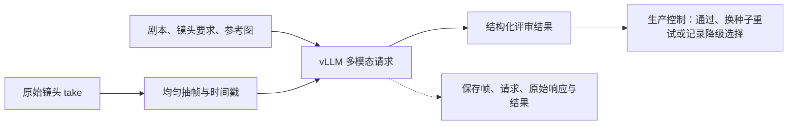

<!--
<document version="0.3.0" updated_at="2026-10-30" keywords="Review,vLLM,Qwen,抽帧,CPU验收" />
-->

# 视频 Review

Review 使用独立 vLLM 服务，默认模型别名为 `qwen-review`。本分支 B200 配置的目标权重为 [nvidia/Qwen3.8-Flash-Next-NVFP4](https://huggingface.co/nvidia/Qwen3.8-Flash-Next-NVFP4)，具体运行版本与共享显存设置见 [部署说明](deployment.md)。CPU 开发环境不下载或部署权重；配置与契约测试不代表该模型已经在本分支完成 B200 性能验收。



## 输入与结果

每段视频分成 `sample_frames` 个时间区间，在区间中点取帧；默认 8 帧，最长边 640 像素。帧按播放顺序附时间戳，与剧本、正负 Prompt、验收要求和各镜头参考图一起通过本地 Base64 图片传入 `/v1/chat/completions`。服务不访问公网素材。

结果包含 `available`、`passed`、`summary`、`issues`、`warnings`；明确的视觉问题记录 `shot_id`、`category=generation`、`message` 与观察到的 `timestamps`。轻微瑕疵、审美偏好和抽帧无法确认的内容只记 warning。自动审核仅接受单镜头范围，整片剪辑与终审交给人工；不存在 `suggested_prompt` 替换权限。

请求失败、截断、非 JSON、无有效证据的拒绝或未知镜头编号保留错误记录，并标记 `available=false`。生产控制从已有可用 take 中随机选择并记 `review_unavailable`，不会把服务故障写成审核通过，也不会因此重新生成视频。视觉明确不通过时只在剩余自动预算内换 seed，原始提示词和素材绑定保持不变。

调用使用 vLLM 的 [`structured_outputs.json`](https://docs.vllm.ai/en/stable/features/structured_outputs/) 约束格式，未使用已弃用的 `guided_json`。每次评审保存 `frames/`、`request.json`、`response.txt`、`result.json`；服务或解析错误另存 `error.txt`。

## 实现取舍

| 方式 | 依赖与收益 | 限制 |
| --- | --- | --- |
| 带时间戳的图片序列（当前） | 使用 vLLM 官方多图输入；FFmpeg 在业务侧抽帧，帧与请求可直接复盘 | 稀疏采样可能漏掉短暂缺陷，不等同完整视频理解 |
| 直接视频输入 | Qwen/vLLM 支持视频输入，可利用模型的视频处理路径 | 服务侧增加视频解码与采样配置，GPU 上需验证具体版本和采样策略 |

取舍依据为 [vLLM 多模态输入说明](https://docs.vllm.ai/en/stable/features/multimodal_inputs/)。画面审核不评估对白、声线、音乐、口型同步或音质，也不把少量静帧当作动作流畅、帧间无闪烁的证明。ASR 默认关闭；启用后仅在拼接成片上转写，再用文本请求核查剧本差异。该结果供人工参考，不控制生成预算、不触发重做。

## 部署与 CPU 验收

在线准备完整模型目录、处理器与支持目标 NVFP4 权重的 vLLM 运行环境，放入挂载盘。按部署说明固定实际验证过的版本；旧 Qwen3-VL 的最低版本条件不能代替新模型兼容性验证。

```bash
QWEN_MODEL_PATH=/mnt/models/Qwen3.8-Flash-Next-NVFP4 \
REVIEW_GPUS=7 bash deploy/start-vllm.sh
```

`REVIEW_GPUS` 指定可见卡，`REVIEW_TP` 指定张量并行数；B200 默认使用完整 GPU7，和可选 ASR 进程共享显存，不使用 MIG。`review.workers` 与服务的 `REVIEW_MAX_SEQS` 匹配；`REVIEW_MAX_IMAGES` 必须容纳抽帧和参考图总数。上下文、并发和 ASR 的组合按峰值实测留出余量。启动脚本启用离线模式，CPU 项目依赖中不安装 vLLM。

`backend=cpu` 只实际检查视频元数据和抽帧解码，不评价语义画质。`reject_once` 可填镜头 ID，只在其首次尝试评审时拒绝，用于覆盖换种子重试流程；不再使用 `film` 触发自动整片返工。测试记录明确标识模拟判断，不能用来证明模型审片准确率。
