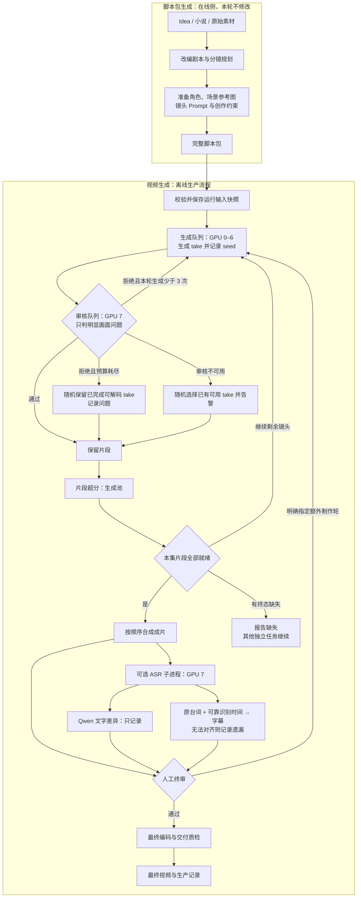

<!--
<document version="0.3.0" updated_at="2026-10-30" keywords="工作流,片段审核,ASR,字幕,随机保留,人工终审" />
-->

# 生产工作流

本次改造只覆盖离线视频生成，线上脚本包生成保持原有职责。离线端使用冻结的有效提示词及资产，先生成并审核片段，再超分、合成和生成音频报告。交接字段见 [交接标准](handoff.md)，操作边界见 [agent 工作指南](agent-guide.md)。

每镜头每个制作轮最多 3 次生成，包含首次；控制和审核不改提示词，只按记录更换 seed。预算耗尽的可用片段继续走超分与合成，并保留未通过标记。没有可解码视频的镜头报告缺失，不以无限等待或新增人工审计代替错误处理。

普通 `resume` 和 `retry` 保持本轮预算；只有显式 `retry --new-round` 才开启额外制作轮，历史累计次数保留。ASR 关闭、不可用、文字差异或字幕未对齐均不触发重生成，不增加人工闸门。正常生产保留最终人工终审；CPU 配置和 `--auto-approve` 可用于无人值守验证，不能据此宣称已完成真实 B200 验收。
