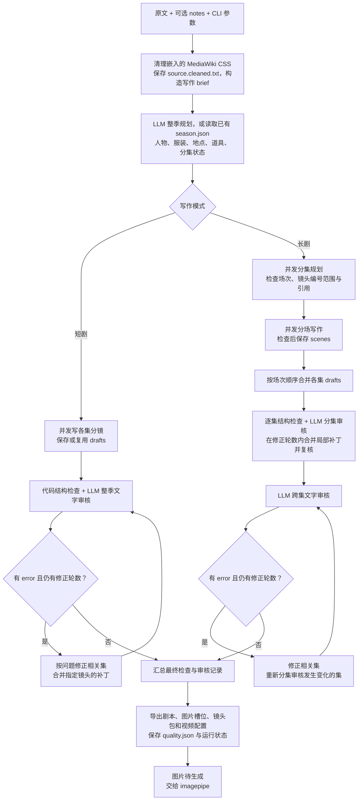
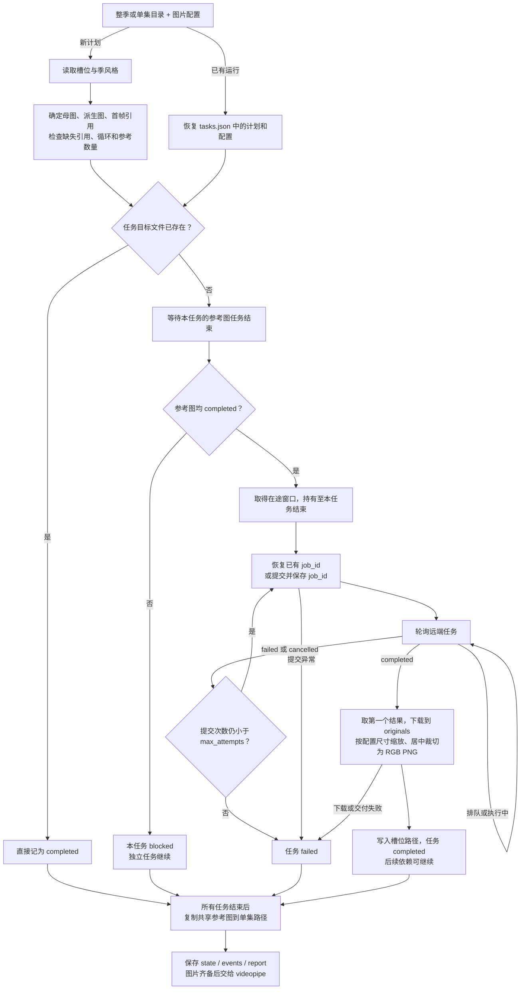
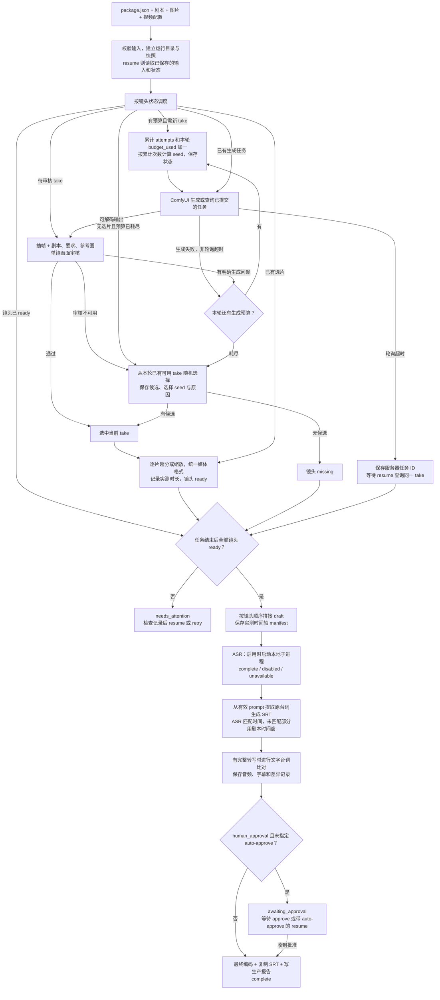

# 生产流程

本文按当前代码说明 `scriptpipe`、`imagepipe`、`videopipe` 的输入、执行顺序、分支和产物，供阅读、运行与修改代码时对照。三个 CLI 独立启动，通过磁盘文件交接；前一段完成后，由调用方启动下一段。

| 阶段 | 读取什么 | 交给下一段什么 |
| --- | --- | --- |
| `scriptpipe` | 原文、可选 `--notes`、写作参数、导出用的视频配置 | 整季设定、逐集剧本与镜头包、图片槽位、各集 `production.yaml` |
| `imagepipe` | 整季或单集目录中的 `image_slots.json`、季风格、图片配置 | 写入槽位路径的共享参考图和镜头首帧；单集目录中的参考图副本 |
| `videopipe` | 单集 `package.json`、其中引用的剧本与图片、视频配置；整季运行另读 `overview.json` | 成片、独立 SRT、生产报告；整季运行还收集汇总与日志压缩包 |

以下生成与审核流程以默认的 Ark DeepSeek、图片任务 API、ComfyUI / vLLM 后端为主。视频另有 CPU 后端：生成参考图缩放预览，审核检查媒体信息和抽帧解码，供本地流程验证。服务地址与模型由配置决定。写作参数来自 CLI 和代码中的 brief；`--production-config` 只决定导出的视频配置。

## scriptpipe：原文到剧本包

### 写作与检查

短剧默认 12 集，brief 中的写作目标是每集 12–15 镜，优选单镜 5.875 秒。长剧由 `--long-form` 选择，集数通过 `--episodes` 配置（默认 8）；每集目标分钟数通过 `--episode-minutes` 配置（默认 5）。每场 12 镜，每集按目标时长取最接近的整场数，至少一场；5 分钟对应 4 场、48 镜、282 秒。长剧检查镜头数量与配置一致、单镜 5.875 秒。这里记录的是剧本计划时长，视频阶段使用生成结果的实测时长。

代码检查覆盖镜头与实体 ID、人物/服装/地点/道具引用、动作和切镜字段、英文说明字段非空且不含中文、对白及计划时长。对白检查包括每镜最多一句、一个说话人、最多 22 个有效字符（含汉字、字母、数字，不计标点和空白），并按 `字符数 / 4 + 0.8` 秒检查时间预算。短剧镜头数在 12–16 之外记为 warning；长剧另检查场次、连续镜头编号、集顺序和全季 ID。LLM 文字审核读取原文、notes、季设定与对应剧本证据，结果与代码检查一起参与修正。

修正与请求重试有三种计数：

| 机制 | 当前行为 |
| --- | --- |
| 文字审核后的局部修正 | `--repair-rounds` 默认 2，可配置为非负整数。短剧用于整季审核循环；长剧用于分集审核循环与跨集审核循环，跨集修正后还会复核变化的集 |
| 长剧结构校正 | 分集规划、分场写作和修正补丁各最多生成 3 次，携带上一版结构错误再请求；仍有结构错误则抛出异常，运行记为 `failed` |
| LLM 请求重试 | 每次 `complete` 最多请求 3 次，处理 HTTP、输出截断、JSON 等错误；请求、响应、用量和错误保存到 `api/` |

局部补丁只能替换已有镜头 ID，未指定的镜头保留；可更新集标题、梗概、开始/结束状态。通用合并函数支持列出所有原镜头的 `shot_order`，长剧还会按场次和编号检查合并结果。审核循环只因 `severity=error` 触发修正。

### 导出、状态与续跑

导出器将人物、服装、镜头内容、声音描述和对白编译为 H3 prompt；对白写入 `<d>[Chinese]原台词</d>`。每镜绑定一张 `first_frame`，人物、地点、道具参考绑定为 `review_only`。导出只创建文本、清单与资产目录，图片文件由后续阶段写入。

| 位置 | 主要内容 |
| --- | --- |
| 剧本运行目录 | `run.json`、`source.cleaned.txt`、`season.json`、`drafts/`、`reviews/`、`quality.json`、`api/`；长剧另有 `creative_brief.json`、`plans/`、`scenes/`、`checks/`、`patches/`、`rejected/`、`review_inputs/` 等阶段记录 |
| 导出根目录 | `overview.json`、`season.json`、`season_bible.md`、`screenplay.md`、`image_slots.json`、`quality.json` |
| `episodes/<集ID>/` | `script.md`、`storyboard.json`、`package.json`、`image_slots.json`、`production.yaml` |

完成检查且导出成功后，`run.json.status` 为 `text_ready` 或 `needs_text_revision`，未消除的错误列在 `quality.json.open_errors`。导出索引相应为 `text_complete_images_pending` 或 `needs_text_revision_images_pending`，`render_ready` 初始为 `false`；文字审核仍有错误时，代码也会导出可导出的包并保留这些记录。

`scriptpipe` 没有单独的 `resume` 子命令，重新使用同一输出目录运行会复用阶段文件。短剧复用已有 `season.json` 和 `drafts`，重新进入审核；长剧会检查缓存的分集规划和分场结果，并在审核输入与保存的输入相同时复用对应审核。长剧支持 `--stop-after season|plans|drafts|review`，其中 `review` 在写完 `quality.json` 后、导出前停止。短剧导出到 `<output>/delivery`；长剧可用 `--delivery` 指定交接目录。

代码依据：[入口](../scriptpipe/cli.py)、[短剧流程](../scriptpipe/pipeline.py)、[长剧流程](../scriptpipe/long_pipeline.py)、[通用检查](../scriptpipe/checks.py)、[长剧检查](../scriptpipe/long_checks.py)、[导出](../scriptpipe/export.py)、[LLM 请求](../scriptpipe/llm.py)。

## imagepipe：图片槽位到实际资产

### 依赖与生成模式

整季输入从 `shared_assets` 和 `first_frames` 建任务；单集输入从 `slots` 建任务，并可从上级季目录补入缺少的母图依赖。依赖规则如下：

| 图片类型 | 引用与生成方式 |
| --- | --- |
| 人物母图 | 资产目录中同一 `character_id` 首个出现的槽位；使用 scriptpipe 导出的清单时，对应该人物第一套服装 |
| 其他服装 | 自动把该人物母图加到参考列表首位；沿用清单和配置中的其他引用 |
| 地点、道具 | 读取清单中的引用；导出器将 `reference_prop_ids` 转为道具资产引用，可形成道具派生关系 |
| 镜头首帧 | 组合槽位中的人物、地点、道具引用；`continuity.sets` 可指定某张首帧作为同组其他首帧的布景锚点，`additional_reference_assets` 可补充引用 |

引用去重后保留顺序，最多 10 张，顺序对应上传图片和 prompt 中的编号。无引用使用文生图；只有一张引用的服装/道具派生使用编辑接口；其余有引用的任务使用参考生成接口。每个任务请求 `n=1`，没有另设图片视觉审核或多候选选图步骤。

### 调度、尺寸与恢复

默认 HTTP 并发为 16、在途任务窗口为 64、轮询间隔为 5 秒。一个任务的依赖完成并落盘后即可推进；在途窗口覆盖提交、轮询、下载和交付。远端任务 `failed` / `cancelled` 时清除 job ID，在 `max_attempts`（默认 3）内重新提交；查询、结果读取和下载另有 HTTP 重试。提交异常会记录为任务失败。存在 job ID 时续跑继续查询该任务；目标文件已经存在时直接复用。

图片交付尺寸由 `generation.width/height` 决定，当前默认和 `configs/imagepipe.yaml` 均为 720×1280。提交时宽高向上对齐 32 像素且至少为 256，因此默认请求尺寸为 736×1280；原图保存后，交付器按目标比例居中裁切并缩放为 RGB PNG。图片尺寸与视频镜头的生成画布分别配置。

运行目录保存 `tasks.json`（最终 prompt、引用、seed、路径、配置）、`state.json`、`events.jsonl`、`originals/` 和 `report.json`。`imagepipe resume <运行目录>` 读取保存的计划和配置；再次 `run` 到已有 `tasks.json` 的目录也会复用它们，并核对包目录是否一致。所有生成任务 `completed` 且参考图复制无缺项时，报告的 `success` 才为 `true`。

图片阶段写入资产与自身运行记录，全剧目录保留文字导出的状态快照。指定 `--episodes ep01-ep10 --delivery <批次目录>` 时，只处理这些集的首帧及引用依赖，再复制成独立视频输入包；后续批次复用全剧目录中的已有图片。批次清单标记 `images_ready`；全剧仍有待修文字问题时保留相应状态。交接时查看图片运行报告及槽位文件；视频入口会检查所引用的文件是否存在。具体命令见 [分批运行](usage.md#全剧文本分批补图与交付)。

代码依据：[入口](../imagepipe/cli.py)、[依赖计划](../imagepipe/plan.py)、[调度与恢复](../imagepipe/pipeline.py)、[接口](../imagepipe/client.py)、[图片交付](../imagepipe/delivery.py)、[配置模型](../imagepipe/models.py)。

## videopipe：镜头包到视频、字幕和报告

图中展开镜头生产与完整交付路径；续跑时会按保存的状态跳过已完成阶段，例如已有草片、音频记录、批准或最终交付。

### 输入、生成与画面审核

`validate` 检查输入格式、ID、引用文件、参数覆盖限制和自定义 workflow 的 API 格式；内置或识别为 H3 的 workflow 还要求 24fps、宽高可被 32 整除。`run` 校验后创建新目录，保存原始包记录、有效 `package.json`、`config.json`，并复制剧本、图片和自定义 workflow 到 `inputs/`。旧格式 `negative_prompt` 在此时合入有效 prompt；旧格式 `reference_images` 的第一张转为首帧，其余转为审核参考。

生成器只把 `first_frame` 资产上传给内置图生视频 workflow；没有首帧时选择文生视频 workflow，`review_only` 图片用于审核。H3 帧数按配置对齐，默认满足 `5 + 17n`，5.875 秒、24fps 对应 141 帧。脚本导出的镜头画布和视频配置为 576×1024、24fps；导出器保留基底配置的超分设置，使用默认 B200 的 2 倍超分时，最终画布为 1152×2048。

每镜每轮 `max_attempts` 默认为 3，配置范围为 1–3。创建 take 时先保存预算，累计 `attempts` 不归零；第 N 个 take 使用 `shot.seed + N - 1`。生成沿用快照中的 prompt 和资产，审核结果及人工 feedback 不改写生成文本。

生成与超分共用线程池和 ComfyUI 实例队列；审核使用单独线程池。生成完成后释放实例，审核期间可生成其他镜头；选片后优先安排该 take 的超分。B200 配置使用 7 个生成 worker、6 个审核 worker。

画面审核当前默认为 **48 帧、最长边 1024**，代码配置模型和 B200 YAML 一致。调用方显式传入这两个配置值；底层 `sample_frames()` 函数的 8 帧 / 640 默认参数不是生产调用的实际默认值。帧按视频等长区间的中点取样，Qwen 接收时间戳、剧本、镜头 prompt、验收要求和参考图。

只有有效结果中关联已知镜头、具有时间戳的 `generation` 问题会使审核不通过；`editing` 或没有时间戳的观察转为 warning。未知镜头、矛盾或不符合格式的响应，以及服务错误，会记为审核不可用。自动画面审核范围是单镜；主流程没有整片自动画面审核循环。

审核通过选中当前 take；审核不可用或本轮预算耗尽时，从本轮已经生成并经媒体检查得到 `source` 的 take 中随机选取，记录 `reason`、候选列表和随机 seed。没有候选则镜头为 `missing`。轮询超时保留 ComfyUI 的 `prompt_id` 和服务地址，续跑继续该任务；超分失败保留选片记录，续跑可继续超分。未捕获到审核结果的执行异常等也可能留下 `failed` 镜头；任务调度结束后，只要有镜头未 `ready`，本集即为 `needs_attention`。

### 媒体、ASR、台词比对与字幕

选中的片段按 `media.upscale` 处理：`comfyui` 调用超分 workflow；`none` 直接规范化；`lanczos` 配置走本地媒体缩放路径。统一画布使用 `media.width/height`，超分未关闭时乘以 `upscale_factor`。内置超分图保留输入音轨和帧率，FFmpeg 规范化保留实测时长，统一帧率、画布与音频格式，无音轨时补静音。全部镜头 ready 后按包内顺序拼接，`manifest.json` 保存各片段的起点、实测时长及选片原因。

内置 H3 workflow 生成视频与音轨，后续流程没有独立 TTS 配音或对白替换步骤。音频处理在拼接后执行，顺序是 **ASR → 字幕 → 台词文字比对 → 保存音频记录**：

| 环节 | 当前行为与记录 |
| --- | --- |
| ASR 调用 | `asr.enabled` 默认为 `true`，CPU 后端默认关闭。每次处理一个草片，由独立 Python 子进程加载本地 faster-whisper；默认模型 `large-v3`、GPU 7、`int8_float16`、超时 600 秒，语言默认自动识别 |
| ASR 执行 | 子进程用 `CUDA_VISIBLE_DEVICES` 选择 GPU，设置离线模式，模型以 `local_files_only=True` 加载；单输入转写开启词级时间戳和 VAD。子进程结束后其模型资源随进程释放 |
| ASR 返回 | 成功为 `complete`；关闭为 `disabled`；缺依赖、缺模型、超时、进程失败或结果校验失败为 `unavailable`，继续后续交付。无效句时间戳跳过；无效词时间戳回退到句时间戳；非空结果中所有句时间戳都无效时记为不可用 |
| 字幕正文 | 从运行快照中的有效 `shot.prompt` 提取 `<d>…</d>`，去掉语言前缀及 `scenetrans` / `cutoff` 指令标记，保留原台词文字和标点；不从画面说明推断对白，也不以 ASR 文本替换正文 |
| 字幕时间 | 用实测片长建立镜头时间窗。在窗内按顺序匹配归一化后的 ASR 词或整句；匹配的台词使用识别时间并裁到镜头窗内。其余台词按有效字符/词数量分配到整镜或相邻匹配台词之间；空间不足时整镜回退到剧本计时 |
| 字幕报告 | `subtitles.json` 记录匹配与回退条目，`timing` 为 `asr`、`script`、`mixed` 或 `none`；没有对白时状态为 `no_dialogue`，仍写出空 SRT |
| 台词文字比对 | 转写为 `complete` 时，vLLM / Qwen 接收预期对白及 ASR 的句段文本和时间，返回 `matches`、`summary`、`differences`。没有完整转写或比对服务不可用时记录 `available=false`；CPU reviewer 不调用语言模型比对 |

ASR 状态、字幕计时方式与台词差异用于报告，不触发视频返工，也不决定批准。当前版本已经保存 `state.audio` 时，`resume` 会跳过音频处理；`retry` 清除下游音频状态，重新拼接后再处理。中断发生在音频状态保存之前时，续跑可能再次执行该阶段。

### 批准、返工与整季交付

默认 `human_approval=false`，音频记录写完后自动交付；设为 `true` 且未传 `--auto-approve` 时进入 `awaiting_approval`。`approve` 只接受该状态。交付进行最终 H.264/AAC 编码，写入 `final.mp4`、独立的 `episode.srt` 和 `production_report.json`，不把字幕烧录进画面。

| 操作 | 实际作用 |
| --- | --- |
| `resume <运行目录>` | 读取输入与配置快照及状态；跳过 ready 镜头，继续已记录的生成任务、待审核 take、已选 take 的超分或后续拼接与交付；保留预算 |
| `retry <运行目录> --shot ID` | 重置指定镜头的选片及片段状态，使用本轮剩余预算；预算耗尽则拒绝该请求。其他镜头复用，清除当前草片、音频、批准和交付指针，后续生成新成片版本 |
| `retry … --new-round` | 指定镜头的 `round` 加一、`budget_used` 归零，累计尝试和旧产物保留；随机选片候选限于新一轮 |
| `--feedback` | 写入返工状态和事件，不修改快照中的生成输入 |
| `status` / `complete` | `status` 输出保存的状态；`complete` 表示交付已完成，选片原因、审核是否可用、ASR 和台词差异分别查看报告 |
| `run-season` | 按 `overview.json.episodes` 顺序逐集执行，集内并发；读取各集配置或使用指定覆盖配置。已有运行从快照恢复，已完成集跳过，某集异常后继续其余集，结束时调用交付收集 |
| `collect` | 从已有运行记录收集视频、SRT、报告和日志；用保存的剧本、实测时长与 ASR 结果重建字幕，并更新相应记录，无需调用模型 |

单集运行记录位于 `state.json`、`events.jsonl`、`shots/<镜头ID>/attempt-NNN/` 和 `shots/<镜头ID>/selection.json`。草片、时间轴及音频记录位于 `film/version-NNN/`，其中 `audio/` 按实际执行情况保存转写、子进程输出、字幕与比对记录；交付位于 `delivery/version-NNN/`。新成片版本保留旧版本文件。

整季运行将单集工作目录放在 `runs/<集ID>/`，收集结果为 `delivery/<集ID>/final.mp4`、`episode.srt`、`production_report.json`，另有 `summary.json`、`summary.md`、`logs/` 和同级 `delivery.tar.gz`。全部集完成才将汇总状态记为 `complete`，否则为 `incomplete`，各集状态和错误保留在汇总中。

代码依据：[CLI](../videopipe/cli.py)、[输入与快照](../videopipe/inputs.py)、[状态机](../videopipe/pipeline.py)、[配置模型](../videopipe/models.py)、[ComfyUI](../videopipe/backends/comfyui.py)、[审核与台词比对](../videopipe/backends/review.py)、[媒体](../videopipe/media.py)、[ASR](../videopipe/backends/asr.py)、[字幕](../videopipe/subtitles.py)、[整季编排](../videopipe/season.py)、[交付收集](../videopipe/delivery.py)。

代码模块与服务协作见 [架构](architecture.md)，具体命令和输入示例见 [使用](usage.md)，环境与模型准备见 [部署](deployment.md)。
