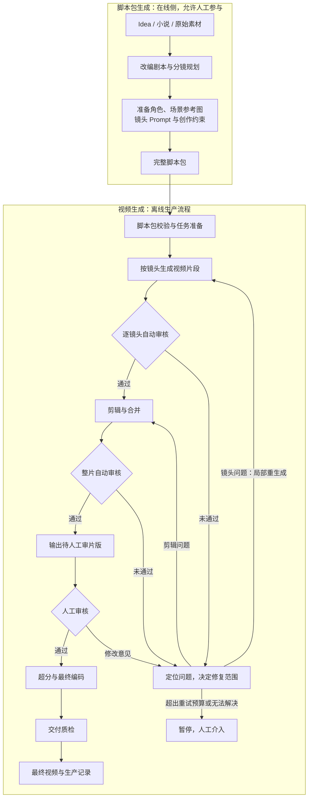

<!--
<document version="0.2.0" updated_at="2026-10-28T21:51:26+08:00" keywords="工作流,脚本包,视频生成,Review,人工审核" />
-->

# 生产工作流

脚本包生成优先级较低，允许半人工半自动，可使用闭源大模型生成参考图。输入为 idea、待改写小说等原始素材，输出包含剧本 Markdown、参考场景与图片、正负 Prompt 等视频生产所需内容。

返工以受影响的镜头或剪辑步骤为单位，并保留生成与评审记录。超出重试预算或无法自动修复时暂停，由人工介入；人工审核通过后再执行超分与最终编码。

初版自动修复执行受影响镜头的重生成。自由文本剪辑建议无法执行时进入人工介入分支，调整输入包后新建运行。CPU 配置和 `--auto-approve` 用于无人值守验证，正常生产配置保留人工审核步骤。
