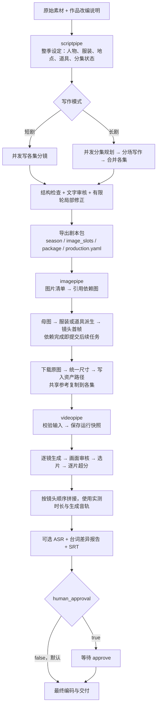
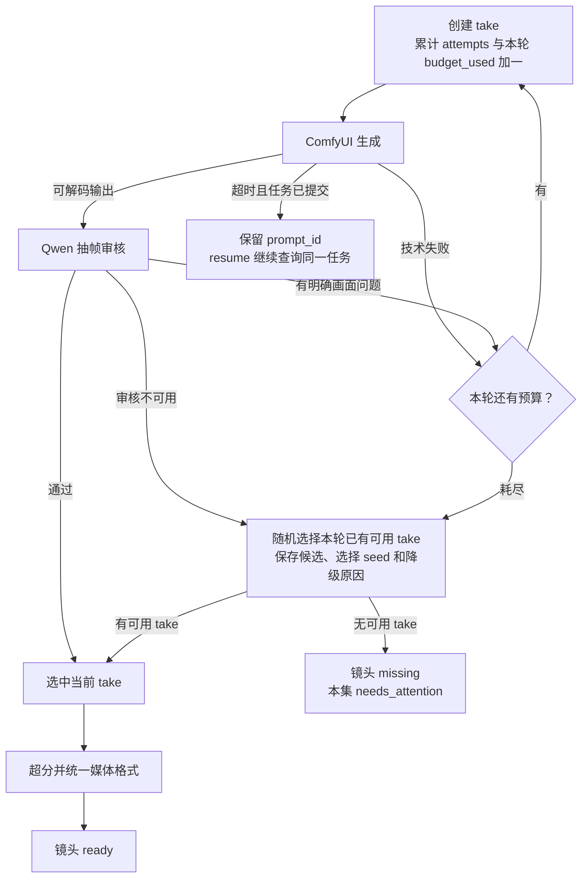

# 生产流程

系统由三个独立 CLI 通过文件交接：`scriptpipe` 编写并导出剧本包，`imagepipe` 补齐图片，`videopipe` 生成和交付视频。前两段调用在线服务，视频段调用部署在本地或内网的服务。

## 三段各自如何决策

| 阶段 | 输入与决策 | 停止与恢复 |
| --- | --- | --- |
| 剧本 | 先建立整季实体 ID 和集间状态，再并发写作；短剧做整季文字审核，长剧先分集审核再跨集审核；修正只替换指定镜头 | 默认最多 2 轮编辑修正；长剧的分集规划、分场写作和补丁另有最多 3 次结构校正。最终仍有问题时保留 `quality.json.open_errors`，导出标为待修正文稿 |
| 图片 | 每个槽位一张图；人物第一套服装为母图，其余服装派生；首帧组合人物、地点、道具及可选布景锚点 | 已有目标文件直接复用；已知 `job_id` 继续查询；依赖失败的任务标为 `blocked`，独立任务继续。当前没有图片视觉筛选环节 |
| 视频 | 每个镜头最多生成 `max_attempts` 次，默认 3、上限 3；原 prompt 和资产固定，seed 随累计尝试编号递增 | 通过的 take 进入超分；预算耗尽或审核不可用时，从本轮已完成可解码的 take 中随机保留，并记录原因；没有可用 take 时该镜头缺失 |

短剧默认 12 集，每集约 12–15 镜；长剧默认 8 集，允许 5–10 集，每场 12 镜，代码按集数计算场数，使计划总长超过一小时。当前导出视频参数是 576×1024、24fps，单镜通常 5.875 秒；作品情节来自原文和 `--notes`。

## 单镜头生成与返工

生成和超分共用生成池，选片后优先安排超分；审核使用另一线程池，等待审核的镜头释放生成实例。其他镜头继续推进，所有镜头 `ready` 后才拼接。

| 操作或结果 | 实际作用 |
| --- | --- |
| `resume` | 从已保存的生成、审核、超分、拼接状态继续，保留预算 |
| `retry --shot ID` | 使用本轮剩余预算重做指定镜头，复用其他镜头；清除下游成片和音频状态，生成新版本 |
| `retry --shot ID --new-round` | 选定镜头进入新制作轮，本轮预算归零，累计次数及历史产物保留 |
| `--feedback` | 写入返工记录；生成文本保持快照内容 |
| `complete` | 已交付；具体画面审核是否降级、ASR 是否可用仍需看生产报告 |

## 审核、声音与交付

- **画面审核**：默认均匀取 8 帧、最长边 640；Qwen 接收剧本、镜头要求、参考图与带时间戳的抽帧。只有关联已知镜头并带时间戳的 `generation` 问题影响选片；其他观察归入 warning。自动审核范围是单镜头。
- **声音**：H3 原生生成音轨；逐片超分和拼接保留实测时长与音轨，缺音轨时补静音。拼接后，每个成片版本执行一次可选 ASR 子进程，退出后释放其资源。
- **字幕**：正文取有效 prompt 中的 `<d>` 原台词；匹配 ASR 时使用识别时间，其余按镜头时间窗或相邻已匹配台词分配。报告用 `asr`、`script`、`mixed` 标记计时方式；无对白也交付空 SRT。
- **台词差异**：Qwen 只比较预期对白与 ASR 句段文本，结果记录在音频报告；ASR 和差异结果均不触发视频返工。
- **整季**：`run-season` 按 `overview.json` 顺序逐集运行，集内并发；跳过已完成集，某集失败后继续其余集。`collect` 从已有记录整理视频、SRT、报告和精简日志，无需调用模型。

代码入口与服务协作见 [架构](architecture.md)，操作和产物位置见 [使用](usage.md)。
